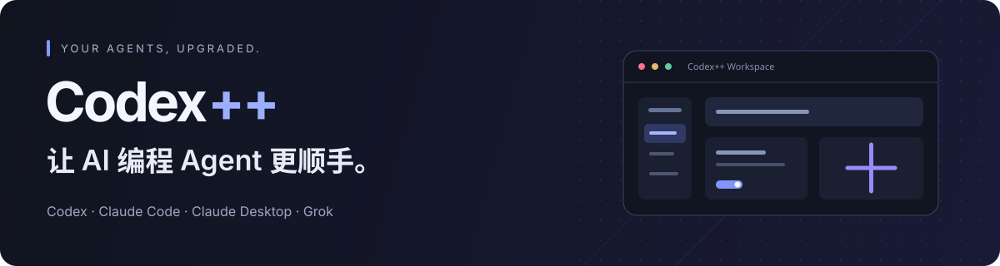
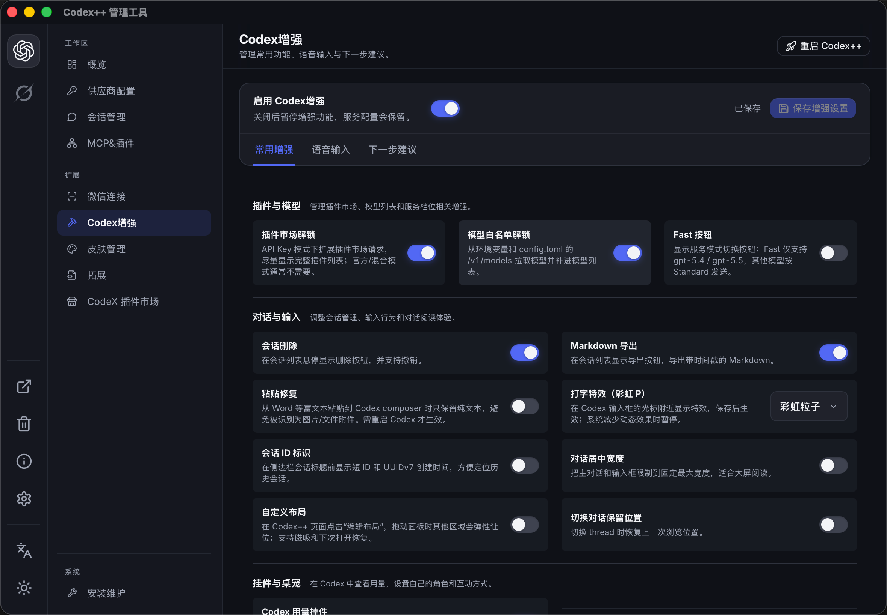
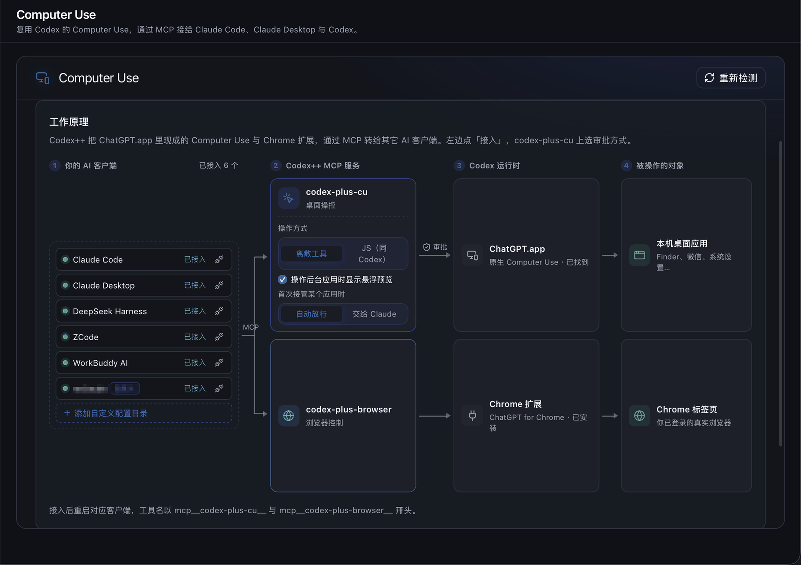
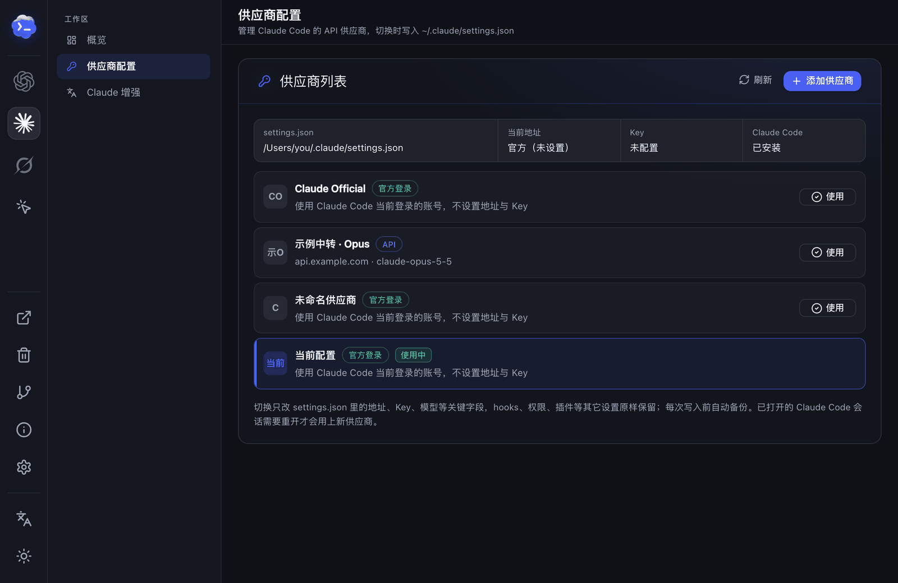
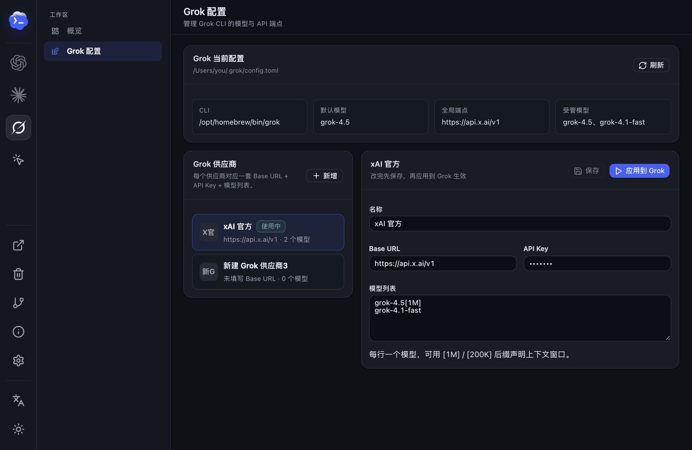
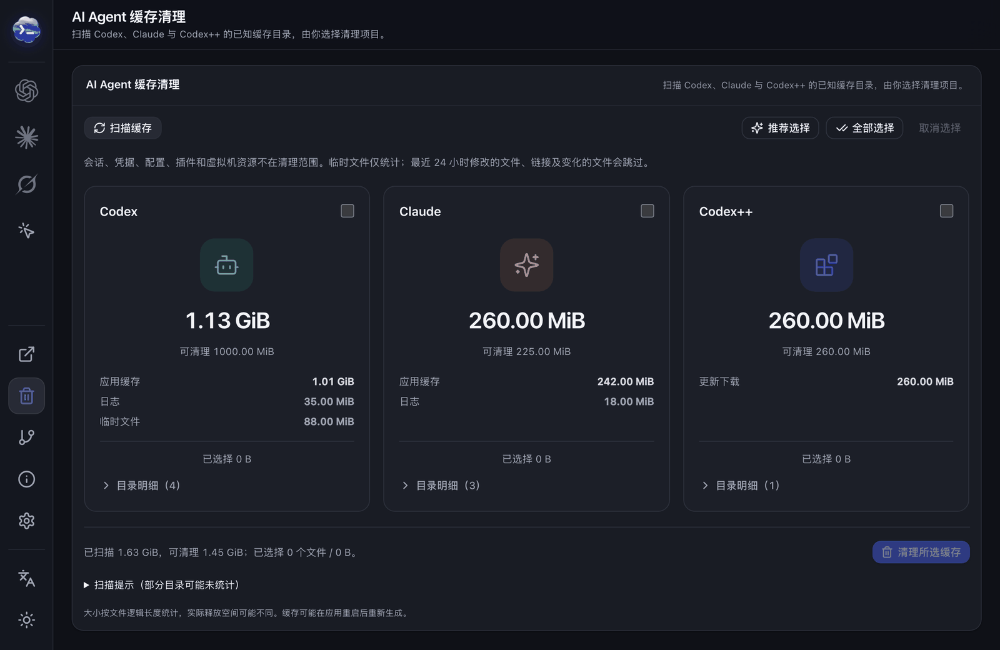
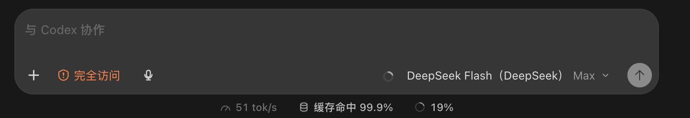
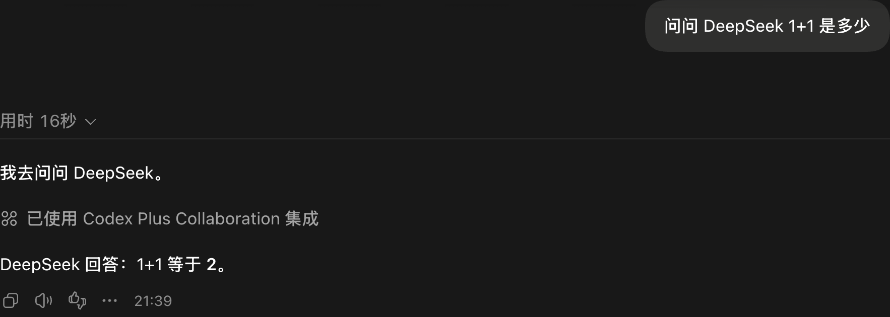
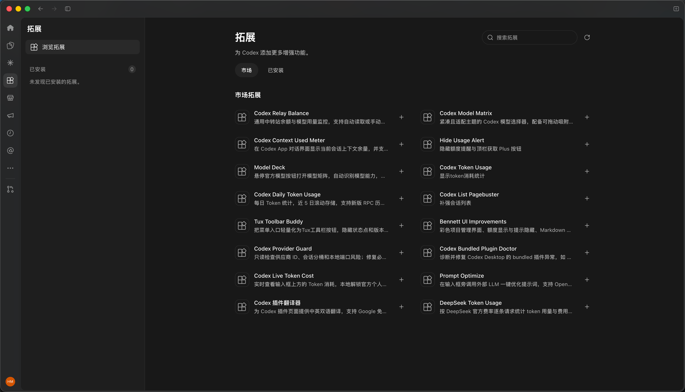
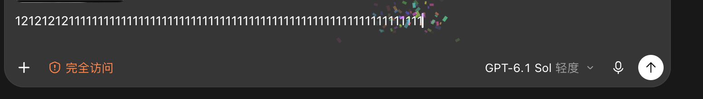

<p align="center">
  
</p>

<p align="center">
  <strong>给你的 AI 编程 Agent 加一点「++」。</strong><br>
  以 Codex 为核心，同时管理 Claude Code、Claude Desktop 与 Grok，还能把 Computer Use 共享给各个 Agent。
</p>

<p align="center">
  <a href="https://github.com/xxloocee/AgentDesk/releases"></a>
  <a href="https://github.com/xxloocee/AgentDesk/stargazers"></a>
  <a href="LICENSE"></a>
  
  
</p>

<p align="center">
  <a href="https://github.com/xxloocee/AgentDesk/releases"><strong>下载最新版 ↗</strong></a> &nbsp; · &nbsp;
  <a href="#快速上手">快速上手</a> &nbsp; · &nbsp;
  <a href="#功能一览">功能一览</a> &nbsp; · &nbsp;
  <a href="https://github.com/xxloocee/AgentDesk/issues">反馈问题</a> &nbsp; · &nbsp;
  <a href="README_EN.md">English</a>
</p>

<p align="center">
  
  <br><sub>从供应商配置到界面增强，一个管理工具就够了。</sub>
</p>

AgentDesk 是 AI 编程 Agent 的统一管理应用。它从 OpenAI Codex / ChatGPT 桌面应用起步，提供供应商切换、协议转换、会话管理和界面增强；现在也管理 Claude Code、Claude Desktop 与 Grok CLI，并提供跨 Agent 的 Computer Use 与子 Agent 协作。双击打开配置界面，再从界面启动各个应用。它不修改任何官方应用的安装文件。

## 功能一览

| Agent | AgentDesk 能做什么 |
| --- | --- |
| **Codex 桌面版** | 供应商切换与协议转换、请求避震、会话管理、界面增强、多开、拓展与桌宠 |
| **Claude Code** | 供应商一键切换、接入 Computer Use |
| **Claude Desktop** | 增强版（中文界面、语音输入、Computer Use）、接入 Computer Use |
| **Grok CLI** | 模型与 API 端点配置 |
| **DeepSeek Harness 等** | 接入 Computer Use、在 Codex 对话中作为子 Agent 调用 |

<table>
  <tr>
    <td width="50%" valign="top"><strong>🔌 供应商自由切换</strong><br>官方登录、官方 + API、纯 API、故障转移与模型聚合。</td>
    <td width="50%" valign="top"><strong>🧠 每个模型，各有空间</strong><br>按模型设置上下文窗口与自动压缩阈值。</td>
  </tr>
  <tr>
    <td valign="top"><strong>🖱️ Computer Use 共享 · 新</strong><br>把 Codex 的桌面与浏览器控制接给其他 Agent。</td>
    <td valign="top"><strong>🤖 Claude Code 与 Grok · 新</strong><br>供应商切换、Claude 增强版、Grok CLI 配置。</td>
  </tr>
  <tr>
    <td valign="top"><strong>🛡️ 请求避震与请求日志</strong><br>过载自动重试，每次请求都看得见。</td>
    <td valign="top"><strong>🤝 子 Agent 协作</strong><br>在 Codex 对话里委派 DeepSeek、Claude Code。</td>
  </tr>
  <tr>
    <td valign="top"><strong>💬 会话管理</strong><br>扫描、删除撤销、导出、<a href="docs/turn-rewind.md">轮次回退</a>。</td>
    <td valign="top"><strong>🧵 Codex 多开</strong><br>每个供应商一个隔离实例。</td>
  </tr>
  <tr>
    <td valign="top"><strong>✨ 输入与阅读</strong><br>语音输入、粘贴修复、下一步建议、打字特效。</td>
    <td valign="top"><strong>📊 用量状态栏</strong><br>速度、缓存命中与上下文占用。</td>
  </tr>
  <tr>
    <td valign="top"><strong>⚡ API Key 原生 Fast</strong><br>纯 API Key 也能用 Standard / Fast 控件。</td>
    <td valign="top"><strong>🧩 拓展与插件</strong><br>社区脚本、MCP、Skill 与 Codex 插件。</td>
  </tr>
  <tr>
    <td valign="top"><strong>📱 微信连接</strong><br>扫码连接本机 Codex。</td>
    <td valign="top"><strong>🧹 AI Agent 缓存清理 · 新</strong><br>扫描并清理 Codex、Claude 缓存。</td>
  </tr>
  <tr>
    <td valign="top"><strong>🐳 Agent 桌宠 · 新</strong><br>点一下会压扁、带音效，图片随心换。</td>
    <td valign="top"><strong>🎨 皮肤与个性化</strong><br>社区主题与自定义图片。</td>
  </tr>
</table>

所有增强都能单独开关；关闭增强总开关后，供应商与启动管理照常可用。

## 看看它能做什么

### 概览：当前供应商、最近请求与健康检查，一屏看完

<p align="center">
  
</p>

### Computer Use：把 Codex 的桌面控制借给其他 Agent

给客户端点「接入」，重启后就能在 Claude Code、Claude Desktop、DeepSeek Harness 等里操作桌面和浏览器。目前仅支持 macOS。

<p align="center">
  
</p>

### 请求日志与自动重试

<p align="center">
  
</p>

<p align="center">
  
</p>

### Claude Code 与 Grok，也在同一个地方管

<table>
  <tr>
    <td width="50%" valign="top"><strong>Claude Code 供应商</strong><br></td>
    <td width="50%" valign="top"><strong>Claude 增强版</strong><br></td>
  </tr>
  <tr>
    <td valign="top"><strong>Grok 配置</strong><br></td>
    <td valign="top"><strong>AI Agent 缓存清理</strong><br></td>
  </tr>
</table>

### 用量状态栏

<p align="center">
  
</p>

### Codex 多开

<p align="center">
  
</p>

### 在 Codex 对话里，直接请其他 Agent 帮忙

对 Codex 说「让 DeepSeek 实现这个功能」，结果回到当前对话。配置见 [子 Agent 协作指南](docs/agent-collaboration.md)。

<p align="center">
  
</p>

### 模型选择器按供应商分组

<p align="center">
  
</p>

### 拓展市场

<p align="center">
  
</p>

### 认真工作，也可以有点趣味

<p>
  <strong>光标打字特效</strong><br>
  
</p>

**Agent 桌宠**：在 Codex 里放一只可拖动的桌宠，点击会压扁并播放音效；图片可从内置图库（Fluent Emoji，运行时联网拉取）挑选，也可填自己的 https 图片地址。在管理器「Agent 桌宠」页开启，目前支持 Codex，说明见 [Agent 桌宠](docs/agent-pet.md)。

<details>
  <summary><strong>纯 API Key 如何开启原生 Fast</strong></summary>

1. 打开「Codex 增强 → 常用增强」，开启增强总开关与「原生 Fast 强制解锁」（默认关闭）。
2. 在「供应商配置」中为该模型设置「Fast（priority）支持」并保存。
3. 从 AgentDesk 重启 Codex，在模型菜单中选择 **⚡ Fast**。

实际可用性与计费由供应商决定。

</details>

## 快速上手

**1. 下载安装包**：前往 [GitHub Releases](https://github.com/xxloocee/AgentDesk/releases)。

| 你的设备 | 安装包 |
| --- | --- |
| Windows · x64 | `AgentDesk-*-windows-x64-setup.exe` |
| macOS · Apple Silicon / Intel | `AgentDesk-*-macos-universal.dmg` |

**2. 打开 AgentDesk 完成配置**：确认官方 Codex / ChatGPT 桌面应用路径，选择供应商，按需开启增强；使用 Claude、Grok 相关功能时需安装对应客户端。

**3. 点击「启动 Codex」**：依赖注入的设置需在界面中重启 Codex 才生效。

<details>
  <summary><strong>从旧版 macOS 升级</strong></summary>

新发布的 DMG 会保留一个隐藏的兼容壳，让 v1.7.x 的旧更新器可以自动替换两个旧 app；更新后首次启动会自动将兼容壳移到 `~/.agentdesk/legacy-migrations`，Applications 中只保留 AgentDesk。v1.5/v1.6 的旧版本只会打开 DMG，请把其中可见的 **AgentDesk.app** 拖入「应用程序」替换一次；新版启动时同样会自动归档旧的 **AgentDesk 管理工具.app**。原有配置与会话数据继续沿用。

</details>

## Codex 供应商与模型

| 模式 | 适用场景 |
| --- | --- |
| **官方登录** | 使用 ChatGPT / Codex 官方账号。 |
| **官方登录 + API** | 保留官方登录与插件入口，模型请求走兼容 API（不消耗官方额度）。 |
| **纯 API** | 自定义 Base URL / Key，无需官方账号。 |
| **聚合供应商** | **故障转移**：多个供应商之间失败切换与轮转。**模型聚合**：带 `cpx-供应商ID/模型名` 前缀的模型固定发往对应成员。 |

在模型列表中加窗口后缀，即可给每个模型设置自己的上下文窗口：

```text
deepseek-v4-pro[1M]
your-model[200K]
another-model[128000]
```

API Key 只保存在本机，提交反馈前请隐藏密钥与认证信息。

## 常见问题

<details>
  <summary><strong>启动后，为什么没有 AgentDesk 菜单？</strong></summary>

确认在 **AgentDesk** 界面中点击「启动」打开官方应用。打开「安装维护」与「关于」页面，检查应用路径、启动状态和诊断日志。

</details>

<details>
  <summary><strong>切换供应商后，请求为什么失败？</strong></summary>

先在供应商详情中运行模型测试或 Provider Doctor，确认协议、Base URL、Key 与模型匹配。纯 API 和官方登录 + API 使用不同的认证位置，不要手工复制两种模式的 `auth.json`。

</details>

<details>
  <summary><strong>Computer Use 接入后，客户端里为什么没有工具？</strong></summary>

接入后需要重启对应客户端才会加载工具；Claude Desktop 退出时会重写自己的配置，建议先完全退出再接入。仍然没有时，在「Computer Use」页的「配置路径与自定义目录」里核对客户端实际读取的配置目录，必要时登记自定义路径；并确认已在系统设置里给 ChatGPT 授予辅助功能与屏幕录制权限。

</details>

<details>
  <summary><strong>增强功能可以关闭吗？官方应用更新后还能用吗？</strong></summary>

可以分别关闭，也可以关闭增强总开关。AgentDesk 依赖官方桌面应用的页面结构、CDP 和本地数据格式；官方应用更新后，部分功能可能需要跟随适配。修改供应商配置或会话数据前，请保留备份。

</details>

<details>
  <summary><strong>配置、会话和日志存在哪里？</strong></summary>

设置了 `CODEX_HOME` 时，Codex 主目录以该变量为准；否则使用 `~/.codex`。

| 数据 | 位置 |
| --- | --- |
| Codex 配置与登录状态 | `~/.codex/config.toml`、`~/.codex/auth.json` |
| 本地数据库 | 优先 `~/.codex/sqlite/*.db`，旧版回退 `~/.codex/state_5.sqlite` |
| AgentDesk 状态与日志 | `~/.agentdesk/` |
| Provider 同步备份 | `~/.codex/backups_state/provider-sync` |

</details>

## 一起把「++」做得更好

欢迎修复问题、完善文档、开发拓展，或分享你的使用建议。感谢每一位贡献者，也感谢帮助定位问题、测试版本和支持项目的人。

<p align="center">
  <a href="https://github.com/xxloocee/AgentDesk/graphs/contributors">
    
  </a>
  <br><sub>代码贡献者头像由 <a href="https://contrib.rocks">contrib.rocks</a> 生成，点击查看贡献记录。</sub>
</p>

<details>
  <summary><strong>开发与本地检查</strong></summary>

前端位于 `apps/codex-plus-manager`，核心 Rust 库位于 `crates/codex-plus-core`，数据层位于 `crates/codex-plus-data`，界面注入脚本位于 `assets/inject`。

```bash
# 前端检查（先在 apps/codex-plus-manager 安装项目依赖）
cd apps/codex-plus-manager
npm ci
npm run check
npm run vite:build

# Rust 检查（回到仓库根目录）
cd ../..
cargo fmt --all -- --check
cargo test
cargo build --release
```

修改 renderer 注入分片后，运行 `node scripts/assemble-renderer-inject.mjs` 重新组装产物。

</details>

## Star History

如果 AgentDesk 对你有帮助，欢迎 [点一颗 Star](https://github.com/xxloocee/AgentDesk)。

<p align="center">
  <a href="https://www.star-history.com/#xxloocee/AgentDesk&amp;Date">
    <picture>
      <source media="(prefers-color-scheme: dark)" srcset="https://api.star-history.com/svg?repos=xxloocee/AgentDesk&amp;type=Date&amp;theme=dark">
      <source media="(prefers-color-scheme: light)" srcset="https://api.star-history.com/svg?repos=xxloocee/AgentDesk&amp;type=Date">
      
    </picture>
  </a>
  <br><sub>曲线由 <a href="https://www.star-history.com">Star History</a> 提供；在线图表与贡献者头像依赖第三方服务加载。</sub>
</p>

---

<p align="center">
  <br>
  <strong>AgentDesk</strong> · 让 AI 编程 Agent 更顺手。<br>
  <sub>Copyright © 2026 xxloocee · <a href="LICENSE">AGPL-3.0-only</a></sub>
</p>

AgentDesk 的修改与分发、通过网络提供修改后版本的源代码义务，以 [GNU AGPL v3.0](LICENSE) 为准。许可证覆盖本项目自身代码，第三方素材遵循各自声明；不授予 OpenAI、ChatGPT、Codex、Anthropic、Claude、xAI、Grok 等商标或应用资源的权利。

## 致谢

AgentDesk 基于 [BigPizzaV3/CodexPlusPlus](https://github.com/BigPizzaV3/CodexPlusPlus) 二次开发。感谢原作者及所有贡献者为项目奠定的基础。
