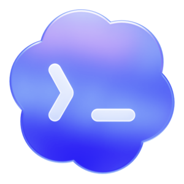

# AgentDesk

<p align="center">
  
</p>

<p align="center">
  <a href="README.md">中文</a> | English
</p>

<p align="center">
  
  
  
  
  
</p>

AgentDesk is an external launcher and manager for the OpenAI Codex / ChatGPT desktop app. It uses the Chromium DevTools Protocol and a local helper for provider switching, protocol conversion, session management, and UI enhancements without modifying the official app's `app.asar` or installation files.

## Quick Start

Download the latest installer from [GitHub Releases](https://github.com/xxloocee/AgentDesk/releases):

- Windows: `AgentDesk-*-windows-x64-setup.exe`
- macOS Intel: `AgentDesk-*-macos-x64.dmg`
- macOS Apple Silicon: `AgentDesk-*-macos-arm64.dmg`

After installation, two entry points are available:

- `AgentDesk`: silently starts the official desktop app with saved provider settings and enhancements.
- `AgentDesk Manager`: manages providers, models, tools, sessions, enhancements, scripts, updates, and diagnostics.

For first-time setup, open the manager, verify the detected app path, configure a provider and optional enhancements, then launch through `AgentDesk`. The Windows installer creates Desktop and Start Menu shortcuts. The macOS DMG installs `/Applications/AgentDesk.app` and `/Applications/AgentDesk 管理工具.app`.

## Current Features

| Area | Capabilities |
| --- | --- |
| Provider configuration | Official login, official login plus API, pure API, and aggregate providers; Responses / Chat Completions; model tests, model discovery, Provider Doctor, cc-switch and deep-link imports |
| Models and context | Per-model context windows, auto-compact limits, `model_catalog_json`, shared config, and per-provider MCP, Skill, and Plugin selection |
| Session management | Local session scanning, bulk deletion, Markdown export, token usage history, Provider metadata sync, and backups |
| Codex enhancements | Plugin marketplace and model whitelist handling, session actions, paste fix, Chinese locale, fast startup, conversation width and scroll restore, service-tier controls, Goals, Stepwise, and image overlay |
| Development workflow | Project move, Upstream worktree creation, thread IDs, and Zed Remote project discovery and opening |
| Scripts and maintenance | User script installation and toggles, app detection, shortcuts, Watcher, environment cleanup, logs, diagnostics, health checks, and Release updates |

Every UI enhancement is independently configurable. Disabling the global enhancement switch still leaves AgentDesk available as a provider and launch manager.

## Provider Modes

Official login, mixed API, and pure API are stored and switched separately:

| Mode | Purpose | Authentication boundary |
| --- | --- | --- |
| Official login | Use only the official ChatGPT / Codex account | Removes custom providers and API keys while preserving official login state |
| Official login + API | Keep official account features and plugins while routing model requests to a compatible API | Stores the key as a provider bearer token, not in pure API `auth.json` |
| Pure API | Use a custom Base URL and key without an official account | Maintains independent `config.toml` and API-key auth without mixing official credentials |
| Aggregate provider | Route across multiple ordinary API providers | Supports failover, conversation round-robin, request round-robin, and weighted round-robin |

Each provider can configure Responses or Chat Completions, model lists, a test model, User-Agent, context windows, auto-compact limits, and enabled MCP servers, Skills, and Plugins. Chat Completions can be converted locally into the Responses protocol used by Codex.

Per-model windows accept values such as `1M`, `200K`, or plain integers. AgentDesk generates a dedicated `model_catalog_json` for Codex.

Provider switching saves the current profile before applying the target profile. Real API keys remain local and should never be posted in logs, screenshots, or issues.

## Codex Enhancements

- Session delete, bulk delete, Markdown export, and project move actions.
- Plugin marketplace unlock, plugin auto-expand, and model whitelist handling.
- Plain-text paste, forced Chinese locale, startup acceleration, and native menu localization.
- Conversation width, scroll restoration, thread IDs, service-tier controls, and Goals.
- Stepwise suggestions with a separate API, model, item count, and timeout.
- Upstream worktrees, Zed Remote, custom image overlays, and user scripts.

Settings that depend on renderer injection generally require saving and restarting Codex.

## Updates and Packages

AgentDesk publishes installers through GitHub Releases. Windows builds an NSIS installer, while macOS builds separate Intel x64 and Apple Silicon arm64 DMGs.

The manager's About page can check and start updates. When the silent launcher finds a new version, it opens the manager directly on the update prompt.

## Data Locations

- Codex config: `~/.codex/config.toml`
- Codex auth state: `~/.codex/auth.json`
- Codex local database: prefers `~/.codex/sqlite/*.db`, falls back to legacy `~/.codex/state_5.sqlite`
- AgentDesk state and logs: `~/.agentdesk/`
- Provider Sync backups: `~/.codex/backups_state/provider-sync`

## FAQ

### The AgentDesk menu does not appear

Launch through the `AgentDesk` entry instead of opening the official app directly. Check the detected app path, launch status, and diagnostic logs in the manager's Maintenance and About pages.

### Requests fail after switching providers

Run the model test or Provider Doctor from the provider detail page. Verify that the protocol, Base URL, key, and test model match. Pure API and official-login-plus-API use different authentication locations; do not manually copy `auth.json` between them.

### macOS says the app cannot be opened or is damaged

Unsigned and unnotarized builds may be blocked by Gatekeeper. Allow the app in System Settings -> Privacy & Security. For formal distribution, configure Apple Developer ID signing and notarization.

### Does it support Intel Macs?

Yes. Releases provide both `macos-x64.dmg` and `macos-arm64.dmg`. Intel Macs should use the x64 package, while Apple Silicon Macs should use the arm64 package.

## Development

```bash
cd apps/codex-plus-manager
npm ci
npm run check
npm run vite:build

cd ../..
cargo fmt --all -- --check
cargo test
cargo build --release
```

Project structure:

```text
apps/
  codex-plus-launcher/          Silent launcher
  codex-plus-manager/           Tauri manager
assets/inject/
  renderer-inject.js            Enhancement script injected into Codex
crates/
  codex-plus-core/              Launch, injection, config, update, install, bridge
  codex-plus-data/              Session data, export, Provider Sync
scripts/installer/
  windows/AgentDesk.nsi     Windows NSIS installer
  macos/package-dmg.sh          macOS DMG packager
```

## License

Copyright (C) 2026 xxloocee

AgentDesk is licensed under the [GNU Affero General Public License v3.0](LICENSE), SPDX identifier `AGPL-3.0-only`. Modified versions that are distributed or offered to users over a network must provide the corresponding source code as required by AGPLv3.

The license covers AgentDesk code only. It does not grant rights to OpenAI, ChatGPT, Codex trademarks, application assets, or other third-party content.

## Compatibility

AgentDesk depends on the official desktop app's page structure, CDP behavior, and local data formats. Official app updates may require injection updates. Keep backups before changing provider configuration or local session data.

## Acknowledgements

AgentDesk is based on [BigPizzaV3/CodexPlusPlus](https://github.com/BigPizzaV3/CodexPlusPlus). Thanks to the original authors and contributors for their work.
